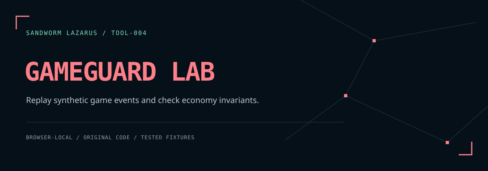

# Sandworm GameGuard Lab



A browser-local game-economy replay lab. Compare a deliberately unchecked baseline with an implementation that validates account ownership, available balances and stock, idempotency keys, and atomic event application. Built with the [Sandworm Lazarus](https://sandworm-lazarus.pages.dev/) dark theme.

[คู่มือภาษาไทย](README.th.md) · [Scenario schema](docs/SCHEMA.md) · [Threat model](docs/THREAT_MODEL.md)

**This is a synthetic, sequential, in-memory model. It is not a deployed game server, a database transaction implementation, or evidence that a real server resists concurrent requests.** No external target is contacted. No downloaded or pasted code is executed.

## Start

No package installation or build is required. With Python 3:

```sh
python3 -m http.server 8080 --bind 127.0.0.1 --directory dist
```

Open `http://127.0.0.1:8080`. Node.js 20+ is required only for the tests and fixture runner. SHA-256 uses browser Web Crypto, available on localhost and HTTPS. The bundled fonts and artwork require no CDN.

1. Select one of six synthetic scenarios, or edit/import a scenario JSON file.
2. Choose **เปรียบเทียบ Replay** to compare the baseline and guarded states.
3. Inspect each event's reason and the state invariants. Ownership and replay correctness must be judged from event outcomes; numerical conservation alone cannot establish either.
4. Review the report contents and enable its JSON download. Changing input invalidates the previous result.

All data is held in page memory until clear, reload, or close. Exported reports contain account/owner identifiers, event keys, balances, and inventory. Reports are **not automatically redacted**; use fabricated data or review before sharing.

## What the lab demonstrates

| Scenario | Deliberately unchecked baseline | Guarded model |
| --- | --- | --- |
| Repeated transfer | Applies twice | Applies once; identical replay has no additional effect |
| Another account's actor | Applies an unauthorized transfer | Rejects `OWNERSHIP_DENIED` |
| Insufficient funds | Can create a negative balance | Rejects without changing either wallet |
| Overselling | Can make stock negative | Rejects the second purchase |
| Reused key with changed command | Applies both commands | Rejects `KEY_CONFLICT` |
| Excess inventory consumption | Can make quantity negative | Rejects without consuming any item |

The baseline still uses the same input schema and rejects missing account/item references and unsafe purchase multiplication. It intentionally omits ownership, idempotency, funds, stock, and inventory checks; it is an educational comparison, not an exploit tool.

## Semantics

- Account owners and actors are caller-supplied synthetic identifiers. A real service must derive actor identity from authenticated server context.
- Transfer, purchase, and use are supported; there is no minting, trading, drop generation, or refund operation.
- A purchase transfers currency into the treasury. Total wallet currency plus treasury is conserved.
- A successful key reserves its exact normalized command. Identical retries return `replayed` without mutation; a different command with that key is denied. Failed commands do not reserve their keys.
- Each event runs against a candidate state. Rejected candidates never replace the committed state.
- Requests run sequentially. There is no concurrency, persistence, crash recovery, or database locking model.
- Input limit: 256 KiB UTF-8; at most 500 events, 100 accounts, 100 shop items, and 100 inventory entries per account. Input amounts are integers from 0 to 1,000,000,000 (event quantities/amounts and item prices must be positive). Arithmetic checks prevent unsafe guarded results.
- JSON parsing uses the native parser: duplicate JSON object keys use the last value. Duplicate account and shop IDs are rejected. [Schema details](docs/SCHEMA.md).

## Reproduce the evidence

```sh
npm run check
npm run fixtures
```

`npm run check` runs the tests and static checks, then records the runtime, test counts, source/fixture file hashes, and a SHA-256 manifest in `reports/validation.json`. Hosted CI status remains separate.

The 26 engine tests cover successful and rejected transitions, atomic failure, replay identity, overflow, ownership, limits, deterministic execution, and SHA-256 provenance. The fixture runner emits summaries from all six built-in scenarios; [the recorded report](docs/fixture-report.json) is reproducible with `node scripts/run-fixtures.cjs`.

Every browser report includes SHA-256 of the exact fixture bytes (whitespace changes therefore change the hash) and the packaged engine source hash. After changing `dist/gameguard.js`, run `npm run stamp` and tests; the provenance regression test rejects a stale stamp. Hashes are reproducibility evidence, not signatures or proof of trusted authorship.

Node API:

```js
const guard = require('./dist/gameguard.js');
const result = guard.compare(guard.sample('replay'));
console.log(result.guarded.summary); // { applied: 1, denied: 0, replayed: 1 }
const report = await guard.report(guard.sample('stock'));
```

## Project files

- `dist/gameguard.js`: bounded schema, state machine, SHA-256, synthetic scenarios.
- `dist/app.js`: DOM-only controller, import/review/export lifecycle.
- `dist/engine-provenance.js`: generated engine digest.
- `tests/gameguard.test.cjs`: behavioral regression suite.
- `scripts/run-fixtures.cjs`: deterministic fixture evidence.

Application code and original artwork: MIT. Bundled typefaces: SIL OFL 1.1, with notices in [THIRD_PARTY_NOTICES.md](THIRD_PARTY_NOTICES.md). This project is an original Sandworm implementation.

## Sandworm tools

[Skill Doctor](https://github.com/Sandworm-Lazarus/sandworm-skill-doctor) · [Thai Eval Studio](https://github.com/Sandworm-Lazarus/sandworm-thai-eval) · [AI Run Ledger](https://github.com/Sandworm-Lazarus/sandworm-ai-run-ledger) · [Agent Gate](https://github.com/Sandworm-Lazarus/sandworm-agent-gate) · [Privacy Workbench](https://github.com/Sandworm-Lazarus/sandworm-privacy-workbench)
