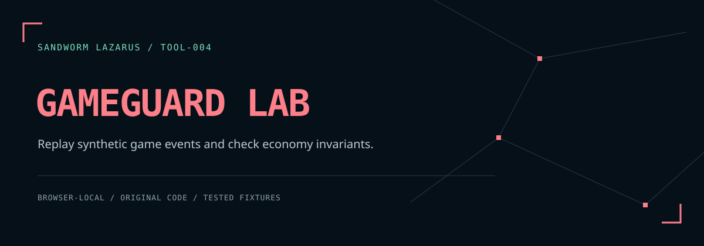

# Sandworm GameGuard Lab



ห้องทดลองเศรษฐกิจเกมในเบราว์เซอร์ เปรียบเทียบคำสั่งโอน ซื้อ และใช้ไอเทม ระหว่าง baseline ที่จงใจขาดการตรวจ กับ guarded model ที่ตรวจสิทธิ์ ยอดเงิน สต็อก คำสั่งซ้ำ และการเปลี่ยนสถานะแบบ atomic

**เป็นแบบจำลองข้อมูลสมมติในหน่วยความจำแบบเรียงลำดับ ไม่ใช่เซิร์ฟเวอร์เกมหรือระบบธุรกรรมฐานข้อมูลจริง และไม่พิสูจน์การป้องกัน race condition** ไม่มีการเชื่อมต่อหรือสแกนเป้าหมายภายนอก

## เปิดใช้งาน

ใช้ Python 3 โดยไม่ต้องติดตั้งแพ็กเกจ:

```sh
python3 -m http.server 8080 --bind 127.0.0.1 --directory dist
```

เปิด `http://127.0.0.1:8080` เพื่อใช้ Web Crypto สำหรับ SHA-256 ฟอนต์และภาพรวมอยู่ในโปรเจกต์ ไม่มี CDN

1. เลือกหนึ่งในหกสถานการณ์สมมติ หรือแก้ไข/นำเข้า JSON
2. กด **เปรียบเทียบ Replay**
3. อ่านเหตุผลแต่ละเหตุการณ์และสถานะบัญชี/ร้านค้าของทั้งสองโมเดล
4. ตรวจข้อมูลในรายงาน แล้วยืนยันก่อนดาวน์โหลด JSON

การแก้ input จะล้างผลเดิมและปิดปุ่มดาวน์โหลด ข้อมูลไม่ถูกส่งออกหรือบันทึกประวัติ แต่รายงานที่ดาวน์โหลดมีชื่อบัญชี/เจ้าของ คีย์เหตุการณ์ ยอดเงิน และไอเทม **ไม่มีการปิดบังข้อมูลส่วนตัวอัตโนมัติ**

## ตัวอย่างที่มี

- Replay คำสั่งโอนเดิม: guarded เกิดผลครั้งเดียว
- ใช้ actor ของผู้เล่นอื่น: ปฏิเสธ ownership
- โอนเงินเกินยอด: ไม่เปลี่ยนทั้งสองบัญชี
- ซื้อเกินสต็อก: ไม่หักเงินหรือเพิ่มไอเทมบางส่วน
- key เดิม แต่ amount ใหม่: ปฏิเสธ key conflict
- ใช้ไอเทมเกินจำนวน: ไม่ทำให้ inventory ติดลบ

ยอดเงินรวมที่คงเดิมไม่ได้พิสูจน์สิทธิ์การเข้าถึงหรือการป้องกัน replay ต้องอ่านสถานะ applied/denied/replayed ประกอบกัน

## ขอบเขต

- JSON UTF-8 ไม่เกิน 256 KiB, 500 events, 100 บัญชี, 100 สินค้า และ 100 inventory entries ต่อบัญชี
- จำนวนเต็มเท่านั้น ตั้งแต่ 0 ถึง 1,000,000,000; จำนวนที่ใช้ในคำสั่งและราคาต้องมากกว่า 0
- treasury รับเงินจากการซื้อ เพื่อให้ตรวจยอดเงินรวมได้
- key ของคำสั่งที่สำเร็จจำ payload แบบ normalized; คำสั่งที่ล้มเหลวไม่จอง key
- actor เป็นข้อมูลสมมติที่ผู้ใช้กรอก ในเซิร์ฟเวอร์จริงต้องได้จากระบบยืนยันตัวตน
- ไม่มีฐานข้อมูล การรันพร้อมกัน crash recovery หรือ server enforcement
- parser ใช้ JSON ของ runtime; ถ้าคีย์ JSON ซ้ำจะใช้ค่าตัวท้าย แต่ entity ID ที่ซ้ำถูกปฏิเสธ

## ทดสอบและตรวจซ้ำ

```sh
npm run check
npm run fixtures
```

`npm run check` รัน tests และ static checks พร้อมบันทึก runtime จำนวน tests และ SHA-256 ของ source/fixtures ใน `reports/validation.json` โดยแยกจากสถานะ hosted CI

ต้องใช้ Node.js 20+ สำหรับการทดสอบ มี regression tests 26 รายการ และ fixture runner 6 สถานการณ์ รายงานมี SHA-256 ของ input ที่รันจริงและ engine ที่แพ็กไว้ ถ้าแก้ engine ให้รัน `npm run stamp` ก่อนทดสอบ hash ไม่ใช่ลายเซ็นรับรองผู้เขียน

[Schema](docs/SCHEMA.md) · [Threat model](docs/THREAT_MODEL.md) · [บันทึกพัฒนา](docs/DEVELOPMENT.md) · [ผล fixture](docs/fixture-report.json)

โค้ดและ artwork ของ Sandworm ใช้ MIT; ฟอนต์ใช้ SIL OFL ตาม [THIRD_PARTY_NOTICES.md](THIRD_PARTY_NOTICES.md)

## Sandworm tools

[Skill Doctor](https://github.com/Sandworm-Lazarus/sandworm-skill-doctor) · [Thai Eval Studio](https://github.com/Sandworm-Lazarus/sandworm-thai-eval) · [AI Run Ledger](https://github.com/Sandworm-Lazarus/sandworm-ai-run-ledger) · [Agent Gate](https://github.com/Sandworm-Lazarus/sandworm-agent-gate) · [Privacy Workbench](https://github.com/Sandworm-Lazarus/sandworm-privacy-workbench)
